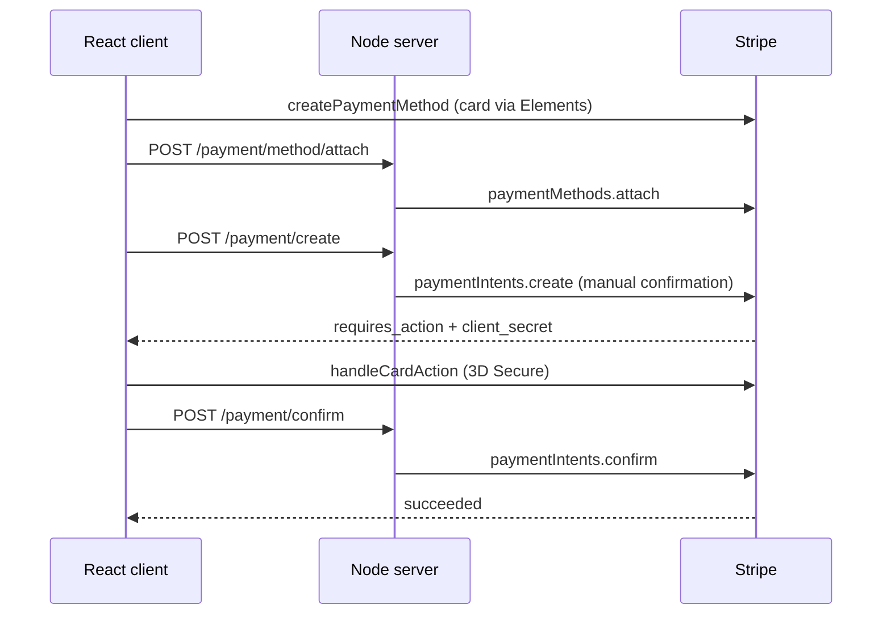

# Stripe Payment Intents with React and Node.js

Companion code for my article
**[Complex Payment Flows Using Stripe Payment Intents: A ReactJS & NodeJS Guide](https://medium.com/better-programming/complex-payment-flows-using-stripe-payment-intents-a-reactjs-nodejs-guide-5835f4c004cf)**
in Better Programming.

A working example of card payments that hold up when the bank asks for 3D Secure:
customers are created in Stripe, cards are saved and reused, and every payment goes
through a Payment Intent that the server creates and confirms.

## What it covers

- **Customers.** Registering a user creates a matching Stripe Customer.
- **Saved cards.** The card is tokenised in the browser with Stripe Elements
  (`createPaymentMethod`), so card details never touch the server, then attached to the
  customer. Saved cards are listed for reuse.
- **Payments with 3D Secure.** The server creates a Payment Intent with
  `confirmation_method: "manual"`. If the bank requires authentication, the client runs
  `handleCardAction` to show the 3D Secure challenge, and the server confirms the intent
  afterwards.



## Run it

You need a Stripe account in test mode.

```sh
# Server (port 5000)
cd server
cp config.example.json config.json   # add your test keys
npm install && npm start

# Client (port 3000)
cd client
cp src/utils/config.example.json src/utils/config.json   # add your publishable key
npm install && npm start
```

Use Stripe's [test cards](https://docs.stripe.com/testing); `4000 0027 6000 3184`
always asks for 3D Secure.

## Notes

- The customer ID, amount and currency are hard-coded in `server/app.js` where a real app
  would read them from its database. The comments mark each place.
- Written in 2022 against `stripe` 8.x and `@stripe/react-stripe-js` 1.x. Stripe has
  since added newer integration options such as the Payment Element, so check
  [their docs](https://docs.stripe.com/payments) before building on this in production.
